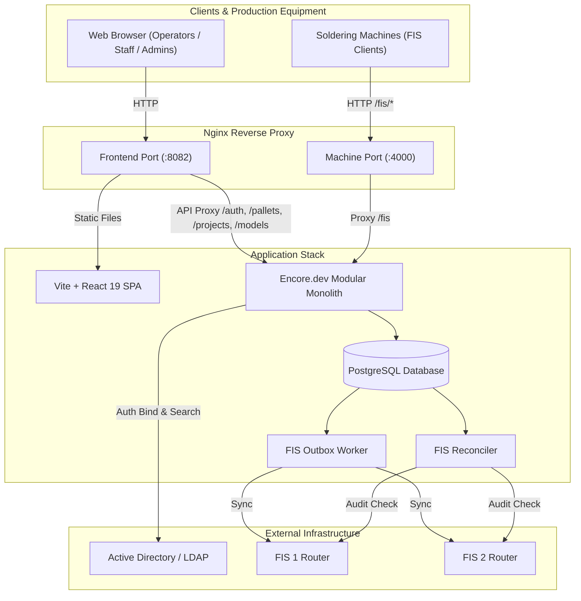

# Paletki — Pallet Management & Lifecycle Tracking System

[](https://nodejs.org/)
[](https://pnpm.io/)
[](https://encore.dev/)
[](https://react.dev/)
[](https://www.typescriptlang.org/)

**Paletki** is a production-grade web application and integration platform designed to streamline the management, tracking, and servicing of physical pallets across factory production and wave/selective soldering lines.

The system enforces automated lifecycle workflows, cycle limit tracking, FIS group-based access with Active Directory / LDAP login, barcode scanning, and reliable asynchronous synchronization with industrial **FIS (Factory Information System)** routers.

---

## Key Features

### 1. Pallet Lifecycle & Inventory Tracking
* **Real-Time Statuses**: `Active`, `Washing_Required`, `Damaged`, and `Blocked`.
* **Automatic Washing Trigger**: Database triggers automatically transition pallets to `Washing_Required` when `current_cycles >= max_cycles`.
* **Soft Deletion & Reactivation**: Pallets can be safely deleted (soft-delete). Re-registering an existing deleted pallet ID reactivates it cleanly without unique constraint collisions.
* **Audit Trail**: Every change (creation, status update, parameter edit, blocking, deletion, reactivation) is logged with localized change descriptions and operator attribution.
* **Audit Trail Export**: Full export of audit logs to JSON/CSV for compliance and analysis.
* **Project Model Catalog**: Pallet models are registered once per project. The pallet form first selects a project and then exposes only models assigned to that project.
* **Copy Pallet Data**: An inventory action pre-fills a new-pallet form from an existing pallet while requiring a new pallet ID.
* **Numbered Range Registration**: The add dialog can atomically create a complete pallet range when IDs share a prefix and use the final two digits as the sequence number (for example `PROJECT-01` through `PROJECT-12`).

### 2. Role-Based Access Control (FIS Groups)
Users authenticate with Active Directory / LDAP. The backend checks group membership in the FIS `users` and `groups` MySQL databases at login and on authenticated requests, following the lookup used by MasterSamples. If FIS group lookup fails, privileged access is unavailable.
The FIS MySQL host must be reachable from the backend container. Grant the configured account `SELECT` on `users.tbl_users`, `groups.groupList`, and the membership tables named by `groupList`.
* **IT (`fisadmin_group` or `admin_group`)**: Full access to all panels, pallet management, audit exports, maintenance and the LDAP Directory User Lookup tool (`/directory`).
* **UR (`FIS_UR_GROUP`, default `Maintenance`)**: Access to the Maintenance Panel to repair damaged pallets, service pallets requiring washing, log service notes, and reset cycle counters.
* **ME (`FIS_ME_GROUP`, default `proceng`)**: Access to pallet management and maintenance panels, excluding the LDAP directory.
* **Operator Session**: Fast-access barcode scanner interface for line operators to scan pallets and report quick defects.

### 3. Industrial FIS Integration & Transactional Outbox
* **Dual FIS Support**: Full compatibility with both **FIS 1** and **FIS 2** routers.
* **Transactional Outbox Pattern**: Pallet updates enqueue durable FIS sync events inside the same PostgreSQL transaction.
* **Resilient Worker & Reconciler**: Dedicated background containers (`fis-outbox-worker` and `fis-reconciler`) consume jobs with lease locking, exponential backoff retries, and daily consistency audits. A temporary FIS router outage never rolls back pallet operations.
* **Bounded Outbox Retention**: Completed jobs are removed in batches after the configured retention period; pending, processing, and dead jobs are preserved.
* **Dedicated Machine Ingress Port**: Separate network port (`FIS_INGRESS_PORT`, default `4000`) for soldering machines calling `/fis/*`, isolating factory equipment from management UI endpoints.

### 4. Operator Barcode Scanner UI & Maintenance Suite
* **Fast Barcode Workflow**: Instant barcode input handling with custom audio cues (success/error chimes) and hotkeys (`1`, `2`) for reporting common faults in seconds.
* **Transparent Error Handling**: Direct presentation of backend validation and business rule messages (e.g. duplicate IDs, invalid status transitions) instead of generic placeholders.
* **Bilingual Localization**: Full Polish (PL) and English (EN) support across all views, audit records, and server messages.
* **Safe Session & Export Handling**: Expired browser sessions are rejected during restoration, and CSV exports neutralize spreadsheet formulas in user-controlled fields.

### 5. Administrative Workflow
1. Register a project with **Add New Project**.
2. Register one or more project-specific models with **Add New Model**.
3. Add a pallet by entering its ID, selecting the project, and then choosing a model from the filtered list.
4. To create a similar pallet, use the **Copy** action in the inventory table. Project, model, cycle limit, nests, and FIS are copied, while the new pallet ID remains empty and must be unique.

The current fresh-install schema creates the project/model catalog in migration
`1_project_model_catalog.up.sql`. The complete eight-migration set is described in
[the migration guide](backend/pallet/migrations/README.md). Before upgrading an
older installation, compare its schema and migration history and back up the database.

### 6. Public Live Dashboard
* **No sign-in required**: both the original project monitor at `/live` and the operational dashboard at `/dashboard` can be opened directly or embedded in another dashboard.
* **Station-aware project detection**: `/dashboard?station=SOLDER-01` and `/live?station=SOLDER-01` show the project assigned to that soldering station. Without the query parameter, both pages present station-selection tiles from the current database assignments.
* **Full fleet mode**: choose **All projects** on either selection screen, or open `/dashboard?station=ALL` and `/live?station=ALL`, to retain the original unfiltered overview.
* **Automatic refresh**: operational data updates every 30 seconds without user interaction.
* **Washing forecast**: pallets at 80% or more of their cycle limit are shown together with pallets already waiting for washing.
* **Service analytics**: the screen shows the current service queue, 14-day turnaround chart, 30-day average turnaround, availability, and project load.
* **Read-only data feed**: `/public/dashboard` intentionally excludes employee names, service comments, block reasons, and raw audit history.

---

## Application Documentation (PL / EN)

Open **Documentation** in the application menu (`/documentation`). Every signed-in
session, including operators, can read all chapters; links to application panels
follow the session's permissions. Search covers instructions, tables and API
examples, ignores accents and case, and matches every word in the query. Share a
chapter with `/documentation?section=status-counters`.

The [standalone documentation](docs/Paletki.html) contains both languages, styles,
search and print layout in one file. Download or copy it and open it locally in a
browser; it does not need a server or internet access. Printing includes all
chapters in the selected language.

The guide distinguishes the current FIS soldering page using `soldering.php`
(inspected on 2026-10-08) from the repository's Encore integration. The running
CGI page is not updated by building Paletki.

```bash
pnpm docs:build  # regenerate docs/Paletki.html from shared bilingual content
pnpm docs:check  # verify that the checked-in HTML is current, without rewriting it
```

The standard frontend build also regenerates the HTML. Update documentation in
`frontend/src/documentation/content.ts`, then regenerate and commit the HTML
together with its source.

## Architecture Overview



---

## Technology Stack

| Layer                     | Technology                                                                           |
|---------------------------|--------------------------------------------------------------------------------------|
| **Frontend**              | React 19, TypeScript, Vite, Tailwind CSS, TanStack Query, Lucide Icons, React Router |
| **Backend**               | Encore.dev, Node.js 24, TypeScript, PostgreSQL                                       |
| **Authentication**        | Active Directory / LDAP over TLS (LDAPS), Token Authentication                       |
| **Background Processing** | PostgreSQL Transactional Outbox, Lease Locking, Docker Compose Workers               |
| **Proxy & Ingress**       | Nginx (multi-port segregation)                                                       |

---

## Project Structure

```text
paletki/
├── backend/                  # Encore.dev backend service
│   ├── auth/                 # LDAP authentication & user directory lookup
│   ├── fis/                  # Soldering machine API endpoints
│   ├── pallet/               # Pallets, project/model catalogs, status and audit trail
│   │   ├── migrations/       # PostgreSQL schema & trigger migrations
│   │   ├── model-catalog.ts  # Project-scoped model catalog endpoints
│   │   ├── database.integration.test.ts # PostgreSQL integration coverage
│   │   └── fis-outbox.ts     # Outbox queue implementation
│   ├── shared/               # Shared types, permissions, i18n, validation
│   └── ARCHITECTURE.md       # Detailed backend domain and architecture rules
├── frontend/                 # React 19 SPA frontend
│   ├── src/
│   │   ├── auth/             # Session management & department access control
│   │   ├── components/       # UI components (modals, forms, tables, pagination)
│   │   ├── hooks/            # Admin, Operator, Maintenance hooks
│   │   ├── i18n/             # Localization dictionary (PL & EN)
│   │   ├── lib/              # API client, audio synthesizer, error extractors
│   │   └── views/            # Admin, Operator, Maintenance, History, Directory views
│   └── tests/                # Frontend unit tests
├── docker-compose.yml        # Multi-container production deployment definition
├── .env.example              # Template configuration for local & production runs
└── package.json              # Monorepo pnpm workspace scripts
```

---

## Getting Started

### Prerequisites
* [Node.js](https://nodejs.org/) 24
* [pnpm](https://pnpm.io/) 11.25.0
* [Docker](https://www.docker.com/get-started) & Docker Compose
* [Encore CLI](https://encore.dev/docs/install)

### 1. Clone & Install Dependencies
```bash
git clone https://github.com/your-username/Paletki.git
cd Paletki

# Install pnpm 11.25.0 globally if not already installed
npm install --global pnpm@11.25.0

# Install dependencies for both frontend and backend
pnpm install
```

> **Windows PowerShell Note:** If script execution is restricted, run using `.cmd` extensions:
> ```powershell
> npm.cmd install --global pnpm@11.25.0
> pnpm.cmd install
> ```

### 2. Configure Environment Variables
Copy `.env.example` to `.env` and fill in the required parameters:
```bash
# Linux / macOS
cp .env.example .env

# Windows PowerShell
Copy-Item .env.example .env
```

Key configuration variables:

| Variable                              | Description                                                      | Default / Example                                              |
|---------------------------------------|------------------------------------------------------------------|----------------------------------------------------------------|
| `VITE_DEV_API_BASE_URL`               | Backend URL for frontend Vite dev mode                           | `http://localhost:4000`                                        |
| `LDAP_URL`                            | LDAPS server connection string                                   | `ldaps://ldap.example.com:636`                                 |
| `FIS_DB_HOST`                         | Host of the FIS MySQL server with `users` and `groups` databases | `fis-db.local`                                                 |
| `FIS_DB_PORT`                         | FIS MySQL port                                                   | `3306`                                                         |
| `FIS_DB_USER`                         | Read-only account for FIS group lookup                           | `paletki_readonly`                                             |
| `FIS_DB_PASSWORD`                     | Password for the FIS read-only account                           | Set as the `FISDBPassword` Encore secret for local development |
| `FIS_UR_GROUP`                        | FIS group for maintenance access                                 | `Maintenance`                                                  |
| `FIS_ME_GROUP`                        | FIS group for ME access                                          | `proceng`                                                      |
| `LDAP_LOOKUP_BIND_USER`               | Directory service account for user lookup                        | `svc_lookup@example.com`                                       |
| `LDAP_LOOKUP_BIND_PASSWORD`           | Password for directory service account                           | `secret`                                                       |
| `FIS1_ROUTER_URL`                     | URL to FIS 1 router endpoint                                     | `http://fis-router-1.local/router.php`                         |
| `FIS2_ROUTER_URL`                     | URL to FIS 2 router endpoint                                     | `http://fis-router-2.local/router.php`                         |
| `FIS_OUTBOX_COMPLETED_RETENTION_DAYS` | Retention period for completed FIS outbox jobs                   | `30`                                                           |
| `FRONTEND_HTTP_PORT`                  | Port exposed by Nginx for the Web App                            | `8082`                                                         |
| `FIS_INGRESS_PORT`                    | Dedicated port for machine soldering calls (`/fis/*`)            | `4000`                                                         |

### 3. Running in Development Mode
Start both frontend and backend in parallel with a single command:
```bash
pnpm dev
```

* **Frontend UI**: `http://localhost:3000`
* **Backend API & Encore Dashboard**: `http://localhost:4000`

To run individual workspaces separately:
```bash
pnpm --filter @paletki/frontend dev
pnpm --filter @paletki/backend dev
```

---

## Testing & Quality Assurance

Run the automated test suites across all workspaces:

```bash
# Run all unit tests (Frontend node:test & Backend Vitest)
pnpm test

# Run PostgreSQL endpoint, transaction, migration/trigger, and outbox integration tests
# Requires Docker because Encore provisions an isolated test database.
pnpm test:integration

# Run TypeScript typechecks
pnpm typecheck

# Run ESLint on backend JavaScript scripts (TypeScript is checked by pnpm typecheck)
pnpm lint

# Run all verification steps together
pnpm check
```

---

## Production Deployment (Docker Compose)

### 1. Build Docker Images & Frontend Bundle
```bash
# Build the Encore backend image (creates paletki-dev:latest)
pnpm build:docker

# Build the frontend production bundle
pnpm build
```

### 2. Start the Production Stack
```bash
docker compose up -d
```

For a Portainer stack created with **Web editor** or **Upload**, set the stack
environment variable `PALETKI_HOST_DIR=/opt/paletki` (or the actual absolute
path to this checkout on the Docker host). The same setting covers the
migrations, LDAP certificate, frontend bundle, and Nginx configuration bind
mounts. These files must already exist on the Docker host. Add the other
variables from `.env` in Portainer's environment variables section; the Web
editor does not load `/opt/paletki/.env` automatically. For a local
`docker compose up -d` from the repository directory, use
`PALETKI_HOST_DIR=./` as in `.env.example`.

If Portainer reports `no migration found for version ...` while the SQL files
exist under `/opt/paletki/backend/pallet/migrations`, check that
`PALETKI_HOST_DIR` is set for the stack. The migrations bind mount is configured
to fail when its source directory does not exist, rather than silently creating
an empty directory.

This launches:
1. `postgres-db` — Dedicated PostgreSQL database.
2. `db-migrations` — Applies all schema, catalog, index, function, and trigger migrations before the backend starts.
3. `backend` — Encore application running the core API services.
4. `frontend` — Nginx serving the SPA on `FRONTEND_HTTP_PORT` (`8082`) and proxying `/fis/*` machine traffic on `FIS_INGRESS_PORT` (`4000`).
5. `fis-outbox-worker` — Reliable worker synchronizing pallet changes with FIS 1 and FIS 2 routers and pruning completed jobs after their retention period.
6. `fis-reconciler` — Background worker running periodic consistency audits between local pallets and FIS routers.

### 3. Check Service Health & Logs
```bash
docker compose ps
docker compose logs -f backend fis-outbox-worker
```

Open the web interface at `http://<SERVER_IP>:8082`.
Soldering machines communicate directly via `http://<SERVER_IP>:4000/fis/...`.

To publish the pallet currently produced by a station, Soldering calls:

```http
PUT /fis/soldering/stations/SOLDER-01/current-pallet
Content-Type: application/json

{"pallet_id":"PROJECT-01"}
```

The assignment is an upsert: another call for the same station immediately switches its dashboard to the project belonging to the newly supplied pallet.

After all FIS unit operations complete, a station records the pallet cycle:

```http
POST /fis/soldering/pallets/PROJECT-01/cycles
Content-Type: application/json

{"station":"SOLDER-01"}
```

The cycle counters and current station assignment are committed in one database
transaction. Every successful request increments the counters. The station script
sends this POST once, without automatic retries or a browser pending-cycle ledger.
Deploy the backend and station script together for this simplified request contract.

The `/fis/*` routes intentionally have no user session because they are consumed by
legacy machines. Access to the machine ingress port must therefore be limited to
trusted production networks at the firewall or reverse proxy.

## PalletX improvements

- Maintenance manages the shared defect catalog (add, rename, delete). Scanner defects set `Damaged`; “Other” requires a description. Washing remains a separate action with its own editable report.
- UR/ME/IT can edit open reports. The original report and its linked history entry are overwritten atomically: no previous text or correction event is retained. Original operator and reporting time remain; the report exposes its last editor and edit time. Returning a pallet to production closes its reports.
- Unblocking requires a comment; blocked pallets show their reason in the scanner.
- Pallets have a required machine (`WSM`, `SSM`, `COAT`), independent of FIS. Migration 7 assigns WSM to existing pallets. No old damage reports are imported.
- `/reports` provides paginated history/current-state reports for UR/ME/IT and complete XLSX export. Dates cover complete days in Europe/Warsaw. Current-state dates refer to status entry, not the last production cycle. Project/model/machine columns show current metadata.
- `pnpm test:postgres` runs endpoint and migration tests on its own disposable PostgreSQL Docker container; it does not require Encore's daemon or touch the application's database.

### Updated navigation and audit

The menu has one Dashboard entry (`/dashboards`) with Live and Operations choices. Maintenance (`/maintenance`) opens a choice of service (`/maintenance/service`) and the separate defect catalog (`/maintenance/defects`). Public `/live` and `/dashboard` links remain available.

Migration 8 stops logging automatic washing transitions, tracks status entry time separately and preserves dashboard service durations in service periods. Unblocking displays its own comment separately from the status. Legacy combined release descriptions are corrected without changing the original comment, author or date.

Frontend scripts resolve Vite, ESLint and tsx from the workspace directly to avoid stale Windows `.bin` paths after pnpm hoisting.

The UR after-washing scanner (`/maintenance/washing`) confirms completed washing on Active/Washing_Required pallets, including early washing. `POST /pallets/confirm-washing` requires UR/ME/IT, the scanned cycle count and its updated_at version, resets only current cycles and records one manual audit event. Damaged/Blocked pallets and stale scanned counts are rejected. No extra database migration is required beyond migration 8.

The Maintenance hub uses four tiles in a 2×2 desktop layout. `/maintenance/history` accepts a scanned or typed pallet ID and opens the existing history viewer at `/maintenance/pallets/:palletId/history`. Individual history is available to UR/ME/IT; bulk audit remains ME/IT only. The operator scanner displays Damaged and Blocked pallets as read-only reason cards. The defect description field appears only for Other and is cleared when switching to a catalog defect; washing reports need no operator comment.

Frontend area bundles (operator, maintenance, dashboards and admin) load on first entry through a shared Suspense resource per area. Once resolved, all views in that area read the module synchronously, avoiding a loading flash on their first visit. All screens within an area share its module; documentation is loaded separately. The authenticated shell remains visible during loading or module errors; reload is manual and keeps the current URL. Full inventory queries run only for admin and maintenance service, with router catalog queries only for admin. Production build emits a Vite manifest and verifies that area modules are absent from the shell static dependency graph and do not eagerly import each other; XLSX stays deferred until export.
